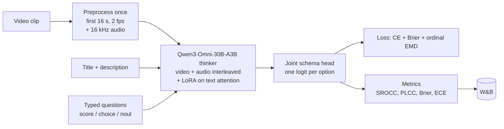

# vjev

Video Jev: a typed, calibrated decision model for short videos.
It answers Jev / SystemOne questions (`choice`, `score`, `noul`) about a video in one forward pass.
It returns a probability for every allowed answer, so code can act on confidence.
The first benchmark is SnapUGC engagement prediction (ECR).

## Status

| Step | State |
|---|---|
| Data pipeline (34,081 SnapUGC clips on Modal) | Done |
| Zero-shot Clef-flash baseline | Done |
| Preprocessing (16 s at 2 fps + 16 kHz audio per clip) | Done |
| Qwen3-Omni + typed head trainer (video + audio) | Done |
| Pilot: 10k clips, video + audio | Running |
| Video-only ablation (same backbone, no audio) | Next |
| Li24 baseline re-run on our split | Planned |
| Full run (30.6k clips) | Planned |

## Results

Test split: 1,736 clips.
Higher SROCC, PLCC and Final is better.
Lower Brier and ECE is better.
A uniform guess over 10 levels has Brier 0.900.

| Model | Trained | Input | SROCC | PLCC | Final | Brier | ECE |
|---|---|---|---|---|---|---|---|
| Clef-flash | No | video + text | 0.128 | 0.127 | 0.127 | 0.912 | 0.064 |
| Clef-flash | No | text only | 0.175 | 0.168 | 0.172 | 1.037 | 0.278 |
| Clef-flash | No | video only | 0.142 | 0.139 | 0.140 | 0.910 | 0.051 |

For context, trained models in the VQualA 2025 challenge reach a final score of 0.66 to 0.71 on the official test set.
Those numbers are not directly comparable, because the official test labels are withheld.
We will re-run the Li24 baseline on our split for a fair comparison.

Full log of every experiment: [`results/README.md`](results/README.md).
Runs: W&B project `sp1d5r/vjev`.

## Findings so far

1. Zero-shot Clef-flash barely ranks engagement (final 0.13 to 0.17).
2. Video does not help without training. The video runs predict close to uniform.
3. Text only is the most confident but badly calibrated (ECE 0.28).
4. Only 32% of SnapUGC videos are still downloadable, and low-engagement videos are deleted more often. Mean ECR is 0.50 over all labels and 0.47 over the clips we have.
5. Video decoding (about 620 ms per clip) is slower than the model forward pass (about 190 ms). It must be fixed before training.

## How it works



The backbone is [Qwen3-Omni-30B-A3B](https://huggingface.co/Qwen/Qwen3-Omni-30B-A3B-Instruct) (Apache-2.0, 3B active parameters).
It reads video frames and the clip's audio on one interleaved timeline.
The head is Cloudflare's [Clef](https://huggingface.co/Cloudflare/clef-flash) joint schema head, trained from scratch on this backbone.
Training follows the Clef recipe: LoRA plus the head, with label-smoothed cross-entropy, a Brier term, and an ordinal term for `score` questions.
ECR is asked as a 10-level `score` question.
The prediction is the probability-weighted score.

## Setup

```sh
uv sync
uv run pytest
```

Modal needs two secrets: `wandb` (`WANDB_API_KEY`) and `huggingface` (`HF_TOKEN`).

## Data

The official SnapUGC val and test labels are withheld.
All splits come from the labelled `train_data.csv` (106,192 rows).
Videos come from the Snap CDN links in that CSV, and we keep the 34,081 links that still work.
The split is `sha256(Id) % 100`: under 5 is test, under 10 is val, the rest is train.

| Split | Clips | Mean ECR |
|---|---|---|
| Train | 30,631 | 0.472 |
| Val | 1,714 | 0.482 |
| Test | 1,736 | 0.463 |

The 10 level edges are ECR deciles over all 106,192 labels, not only the surviving clips.
They are stored in `index/meta.json` on the volume.

```sh
uv run modal run vjev/data.py::upload_labels --csv-path ~/Downloads/train_data.csv
uv run modal run vjev/data.py::pull_videos
uv run modal run vjev/data.py::build_split
```

## Experiments

```sh
uv run modal run vjev/baseline.py --split test --limit 1736             # zero-shot Clef-flash, video + text
uv run modal run vjev/baseline.py --split test --limit 1736 --no-video  # text only
uv run modal run vjev/preprocess.py::preprocess_all                     # decode clips once
uv run modal run --detach vjev/train.py --train-limit 10000 --val-limit 500 --eval-every 200
uv run modal run --detach vjev/train.py --no-audio ...                  # video-only ablation
```

Training runs on one H200 at about 2,500 clips per hour (about $1.80 per 1,000 clips).

## Metrics

- SROCC and PLCC between the expected score and true ECR, as in the VQualA 2025 challenge. Final is their mean.
- Brier and ECE of the 10-level distribution, for calibration.
- Forward latency per clip and clips per hour, for cost.

## License

Code: Apache-2.0.
SnapUGC has no stated license.
Check the dataset terms before redistributing videos.
