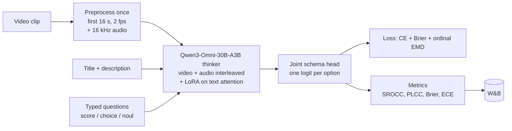

# vjev

Video Jev: a typed, calibrated decision model for short videos.
It answers Jev / SystemOne questions (`choice`, `score`, `noul`) about a video in one forward pass.
It returns a probability for every allowed answer, so code can act on confidence.
The first benchmark is SnapUGC engagement prediction (ECR).

## Status

| Step | State |
|---|---|
| Data pipeline (34,081 SnapUGC clips on Modal) | Done |
| Zero-shot Clef-flash baseline | Done |
| Preprocessing (16 s at 2 fps + 16 kHz audio per clip) | Done |
| Qwen3-Omni + typed head trainer (video + audio) | Done |
| Pilot: 10k clips, video + audio | Done: val final 0.654 |
| Cheap baselines on our split (text XGBoost, CLIP MLP) | Done: CLIP MLP + temperature 0.673 |
| Video-only ablation (same backbone, no audio) | Done: 0.628, audio gap inside noise |
| Omni + CLIP ensemble | Done: 0.695 |
| VideoLLaMA2-AV retrained on our split | Planned |
| Modality dropout (train on A+V, V only, A only, text only views of each clip) | Idea: may make the model use audio; small test first |
| Full run (30.6k clips, E006) | Stopped at step 2,440: collapsed under a long high-LR schedule |
| Medium stability test, lower LR +/- vision LoRA (E008) | Done: stable at LoRA LR 3e-5, 0.677 alone, 0.714 with CLIP; vision LoRA no help |
| Full run, LoRA LR 3e-5, 30.6k clips (E009) | Done: val 0.717, stable for the whole epoch |
| Test split, scored once (E010) | Done: Omni 0.709 against CLIP 0.643 |
| 3 seeds of the final recipe | Planned |
| Learning-rate sweep + vision LoRA test (2k clips, E007) | Done: failures come from a high rate held for 400+ steps; vision LoRA promising |

## Results

Higher SROCC, PLCC and Final is better.
Lower Brier and ECE is better.
A uniform guess over 10 levels has Brier 0.900.

### Headline (test split, 1,736 clips, scored once)

| Model | Training clips | Input | SROCC | PLCC | Final | Brier | ECE |
|---|---|---|---|---|---|---|---|
| **Qwen3-Omni + typed head (E009)** | 30,631 | video + audio + text | 0.708 | 0.709 | **0.709** | **0.818** | **0.028** |
| Omni + CLIP-MLP ensemble | 30,631 + ~27,600 | video + audio + text | 0.711 | 0.708 | 0.709 | 0.816 | 0.033 |
| CLIP + MLP + temperature | ~27,600 | 8 frames | 0.645 | 0.642 | 0.643 | 0.843 | 0.034 |
| CLIP + text + MLP + temperature | ~27,600 | 8 frames + text | 0.642 | 0.636 | 0.639 | 0.859 | 0.029 |
| Text + XGBoost + temperature | ~27,600 | text | 0.348 | 0.347 | 0.347 | 0.884 | 0.029 |

Omni beats CLIP + MLP by +0.065 final (95% paired bootstrap CI [0.041, 0.088]). One seed. See E010 in the log.

### Trained (val split, the same 500 clips for every row)

| Model | Training clips | Input | SROCC | PLCC | Final | Brier | ECE |
|---|---|---|---|---|---|---|---|
| **Qwen3-Omni + typed head, full run (E009)** | 30,631 | video + audio + text | 0.717 | 0.717 | **0.717** | **0.808** | 0.032 |
| Omni (E009) + CLIP-MLP-temperature ensemble | 30,631 + ~27,600 | video + audio + text | 0.727 | 0.724 | 0.726 | 0.813 | 0.032 |
| Omni (E008) + CLIP-MLP-temperature ensemble | 6,400 + ~27,600 | video + audio + text | 0.714 | 0.714 | 0.714 | 0.826 | 0.054 |
| Qwen3-Omni + typed head, LoRA LR 3e-5 (E008) | 6,400 | video + audio + text | 0.675 | 0.679 | 0.677 | 0.833 | 0.042 |
| Same + vision LoRA (E008) | 6,400 | video + audio + text | | | 0.663 | 0.839 | **0.023** |
| Qwen3-Omni + typed head (pilot) | 10,000 | video + audio + text | 0.655 | 0.652 | 0.654 | 0.839 | 0.035 |
| Omni pilot + CLIP-MLP-temperature ensemble | 10,000 + ~27,600 | video + audio + text | 0.696 | 0.694 | 0.695 | 0.829 | 0.030 |
| Qwen3-Omni + typed head, no audio | 10,000 | video + text | 0.627 | 0.626 | 0.628 | 0.847 | 0.029 |
| CLIP + MLP + temperature | ~27,600 | 8 frames | 0.673 | 0.673 | 0.673 | 0.845 | 0.046 |
| CLIP + MLP | 30,631 | 8 frames | 0.666 | 0.658 | 0.662 | 0.876 | 0.144 |
| CLIP + text + MLP + temperature | ~27,600 | 8 frames + text | 0.663 | 0.659 | 0.661 | 0.852 | 0.037 |
| CLIP + text + MLP | 30,631 | 8 frames + text | 0.613 | 0.612 | 0.612 | 1.136 | 0.465 |
| Text + XGBoost | 30,631 | text | 0.336 | 0.316 | 0.326 | 0.899 | 0.055 |

These are val numbers from one seed, and val chose the Omni checkpoints.

### Zero-shot (test split, 1,736 clips)

| Model | Trained | Input | SROCC | PLCC | Final | Brier | ECE |
|---|---|---|---|---|---|---|---|
| Clef-flash | No | video + text | 0.128 | 0.127 | 0.127 | 0.912 | 0.064 |
| Clef-flash | No | text only | 0.175 | 0.168 | 0.172 | 1.037 | 0.278 |
| Clef-flash | No | video only | 0.142 | 0.139 | 0.140 | 0.910 | 0.051 |

For context, the VQualA 2025 challenge ([arXiv 2509.02969](https://arxiv.org/abs/2509.02969)) leaderboard on its official test set:

| Rank | Team | Final | SROCC | PLCC |
|---|---|---|---|---|
| 1 | ECNU-SJTU VQA (ensemble of 4 VLMs, with audio) | 0.710 | 0.707 | 0.714 |
| 2 | IMCL-DAMO | 0.698 | 0.696 | 0.702 |
| 3 | HKUST-Cardiff-MI-BAAI | 0.680 | 0.677 | 0.684 |
| 4 | MCCE / EasyVQA | 0.667 | | |
| - | Challenge baseline | about 0.66 | | |

Our single Omni model scores 0.709 on our own test split, level with first place.
Those numbers are not directly comparable, because the official test labels are withheld.
We retrain the baselines on our exact split for a fair comparison. See [`EVALUATION.md`](EVALUATION.md).

Full log of every experiment: [`results/README.md`](results/README.md).
SnapUGC write-up (parked, stands alone): [`docs/snapugc_findings.md`](docs/snapugc_findings.md).
Findings so far and the plan to generalise: [`docs/findings_and_plan.pdf`](docs/findings_and_plan.pdf) (source: [`docs/findings_and_plan.html`](docs/findings_and_plan.html)).
Live charts in plain language: [W&B report](https://wandb.ai/sp1d5r/vjev/reports/vjev:-can-a-typed-model-predict-video-retention?--VmlldzoxODA3MzM0NQ==) (private).
Runs page in plain language: ["Plain language" view](https://wandb.ai/sp1d5r/vjev?nw=hon9b3fyzh6) (private).
Rebuild them with `uv run python scripts/wandb_report.py` and `uv run python scripts/wandb_workspace.py`.

## Findings so far

1. **On the untouched test split, Qwen3-Omni + typed head reaches final 0.709, against 0.643 for CLIP + MLP trained on the same clips** (+0.065, 95% CI [0.041, 0.088]). It is also better calibrated (Brier 0.818 against 0.843, ECE 0.028). One seed so far (E010).
2. Once Omni is fully trained, an ensemble with CLIP + MLP adds nothing on test (+0.001). Ensembles helped only weaker Omni models (E005, E008).
3. Long runs collapse when the LoRA rate stays near 1e-4. At 3e-5, a full epoch is stable (E006 against E009).
4. The low-rate end of the schedule matters: steps 2,400 to 3,200 added 0.014 val final and lowered Brier from 0.821 to 0.808 (E009).
5. Without audio, the Omni model scores 0.628 against 0.654 with audio at 10,000 clips. The gap is inside the noise, so audio helps at most a little.
6. Vision LoRA did not help at 500 val clips (0.663 against 0.677), though it gave the lowest calibration error (E008).
7. Temperature scaling closes most of the calibration gap for cheap baselines (CLIP + MLP ECE 0.144 to 0.046 on val).
8. Visual features carry most of the signal. Text alone reaches only 0.35 on test.
9. Zero-shot Clef-flash barely ranks engagement (final 0.13 to 0.17). Without training, video does not help, and text only is badly calibrated (ECE 0.28).
10. Only 32% of SnapUGC videos are still downloadable, and low-engagement videos are deleted more often. Mean ECR is 0.50 over all labels and 0.47 over the clips we have.
11. Decoding video on the fly was 3.5x slower than the forward pass, so we decode every clip once up front.

## How it works



The backbone is [Qwen3-Omni-30B-A3B](https://huggingface.co/Qwen/Qwen3-Omni-30B-A3B-Instruct) (Apache-2.0, 3B active parameters).
It reads video frames and the clip's audio on one interleaved timeline.
The head is Cloudflare's [Clef](https://huggingface.co/Cloudflare/clef-flash) joint schema head, trained from scratch on this backbone.
Training follows the Clef recipe: LoRA plus the head, with label-smoothed cross-entropy, a Brier term, and an ordinal term for `score` questions.
ECR is asked as a 10-level `score` question.
The prediction is the probability-weighted score.

## Setup

```sh
uv sync
uv run pytest
```

Modal needs two secrets: `wandb` (`WANDB_API_KEY`) and `huggingface` (`HF_TOKEN`).

## Data

The official SnapUGC val and test labels are withheld.
All splits come from the labelled `train_data.csv` (106,192 rows).
Videos come from the Snap CDN links in that CSV, and we keep the 34,081 links that still work.
The split is `sha256(Id) % 100`: under 5 is test, under 10 is val, the rest is train.

| Split | Clips | Mean ECR |
|---|---|---|
| Train | 30,631 | 0.472 |
| Val | 1,714 | 0.482 |
| Test | 1,736 | 0.463 |

The 10 level edges are ECR deciles over all 106,192 labels, not only the surviving clips.
They are stored in `index/meta.json` on the volume.

```sh
uv run modal run vjev/data.py::upload_labels --csv-path ~/Downloads/train_data.csv
uv run modal run vjev/data.py::pull_videos
uv run modal run vjev/data.py::build_split
```

## Experiments

```sh
uv run modal run vjev/baseline.py --split test --limit 1736             # zero-shot Clef-flash, video + text
uv run modal run vjev/baseline.py --split test --limit 1736 --no-video  # text only
uv run modal run vjev/preprocess.py::preprocess_all                     # decode clips once
uv run modal run --detach vjev/train.py --train-limit 10000 --val-limit 500 --eval-every 200
uv run modal run --detach vjev/train.py --no-audio ...                  # video-only ablation
uv run modal run --detach vjev/train.py --vision-lora --lr-lora 3e-5 ... # also adapt the vision tower
uv run modal run vjev/simple_baselines.py::embed_all                    # text + CLIP features, once
uv run modal run vjev/simple_baselines.py::fit_all [--calibrate]        # cheap baselines (+ temperature)
uv run modal run vjev/predict.py::predict_ckpt --run pilot-omni-av-10k  # per-clip val predictions
uv run python scripts/ensemble.py pilot-omni-av-10k-val500 baseline-clip-mlp-ts-val
```

Rule for spend: test settings on 2,000 clips (about $4) before any run over about $20.

Training runs on one H200 at about 2,860 clips per hour (about $1.70 per 1,000 clips).

## Metrics

- SROCC and PLCC between the expected score and true ECR, as in the VQualA 2025 challenge. Final is their mean.
- Brier and ECE of the 10-level distribution, for calibration.
- Forward latency per clip and clips per hour, for cost.

## License

Code: Apache-2.0.
SnapUGC has no stated license.
Check the dataset terms before redistributing videos.
